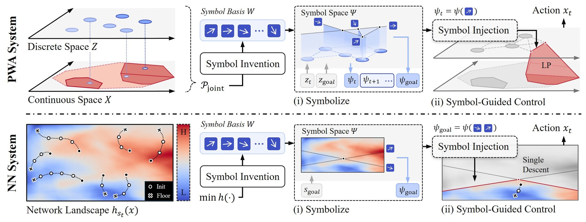

<h1 align="center">What Makes a Good Symbol for<br>Hybrid Discrete–Continuous Planning?</h1>

<p align="center">
  Yiyuan Pan<sup>1</sup>, Changliu Liu<sup>1</sup>, Jiayuan Mao<sup>2</sup><br>
  <sup>1</sup>Carnegie Mellon University &nbsp; <sup>2</sup>University of Pennsylvania<br>
  <a href="https://arxiv.org/abs/2610.23010">Paper</a> · <a href="https://pyywill.github.io/good-symbols/">Project page</a>
</p>

<p align="center"></p>

> **Release status.** This repository contains the code for **PWA (MILP) systems**: CPR symbol invention,
> symbol-guided control and the end-to-end (E2E) MILP baseline on the six PWA tasks.
> The code for **neural-network systems** is to be uploaded.

## Installation

```bash
git clone https://github.com/PyyWill/good-symbols.git && cd good-symbols
pip install -e .
```

CPR needs `cmr-tu` from [CMR](https://github.com/discopt/cmr):

```bash
git clone https://github.com/discopt/cmr.git && cd cmr && mkdir build && cd build && cmake .. && make
export CMR_TU=$PWD/cmr-tu
```

The Shadow Hand tasks (`block`, `cuboid`, `pen`) also need [IsaacLab](https://isaac-sim.github.io/IsaacLab/)
(tested with Isaac Sim 5.1 and IsaacLab 2.3); install this package into its Python environment.

## Usage

Tasks: `mpusht`, `hook`, `shelf`, `block`, `cuboid`, `pen`.

```bash
# Invent symbols with CPR and check them against the released ones
python -m good_symbols.pwa cpr

# Symbol-guided control and the E2E MILP controller
python -m good_symbols.pwa run --task hook --controller symbol-guided --seeds 0:16
python -m good_symbols.pwa run --task hook --controller e2e --seeds 0:16

# Shadow Hand tasks also take a fitted setting (1, 2 or 3)
python -m good_symbols.pwa run --task block --setting 1 --controller symbol-guided --seeds 0:16
```

Results are written to `results/`. For `shelf`, the symbol-guided controller needs about five minutes to start.

**Speed-up.** Across hardware, symbol-guided control is faster than E2E on all six tasks, with a geometric-mean
per-step speed-up of 2.12–2.83× (2.34× in the paper). Exact values depend on hardware and timing protocol and
vary more on individual tasks.

To rebuild a task's data (`data/<task>/`) from scratch:

```bash
python -m good_symbols.pwa collect --task hook --seeds 0:64 --output my_data/hook/demonstrations.npz
python -m good_symbols.pwa build-graph --task hook --demonstrations my_data/hook/demonstrations.npz \
       --output my_data/hook/symbol_graph.json
GOOD_SYMBOLS_DATA=my_data python -m good_symbols.pwa run --task hook
```

## Citation

```bibtex
@article{pan2026good,
  title   = {What Makes a Good Symbol for Hybrid Discrete--Continuous Planning?},
  author  = {Pan, Yiyuan and Liu, Changliu and Mao, Jiayuan},
  journal = {arXiv preprint arXiv:2610.23010},
  year    = {2026}
}
```

## License

Code: [MIT](LICENSE). Data and figures: [CC BY 4.0](https://creativecommons.org/licenses/by/4.0/).
